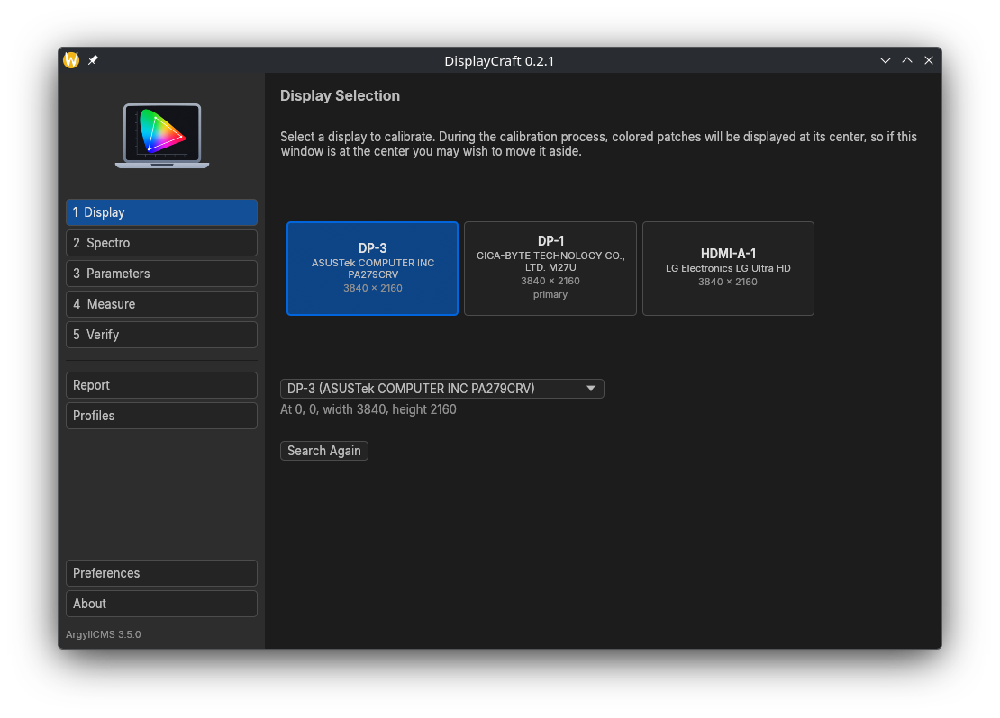
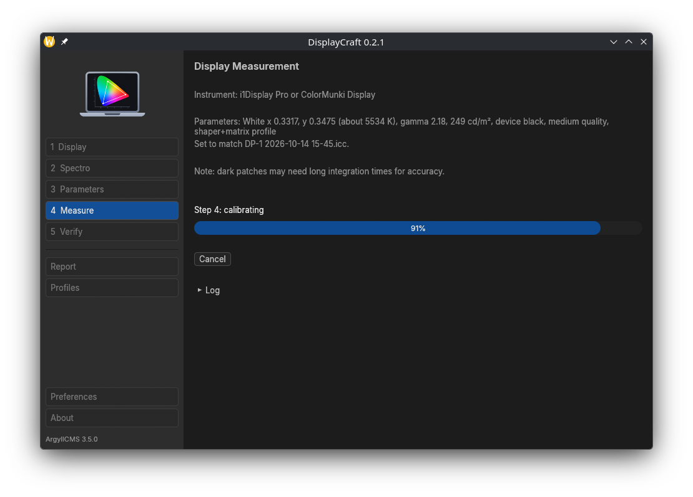
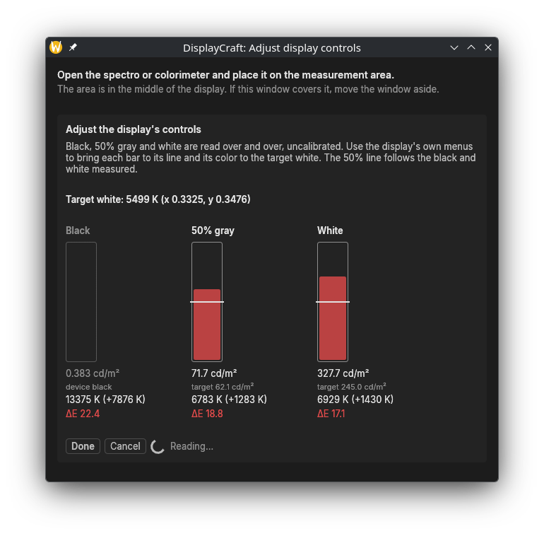
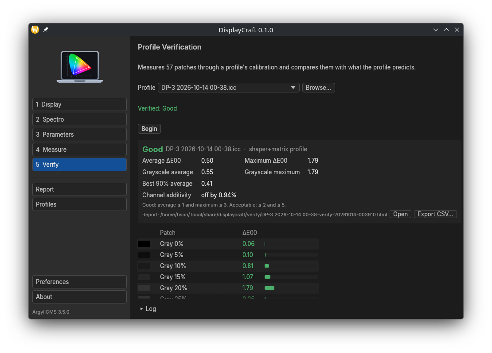
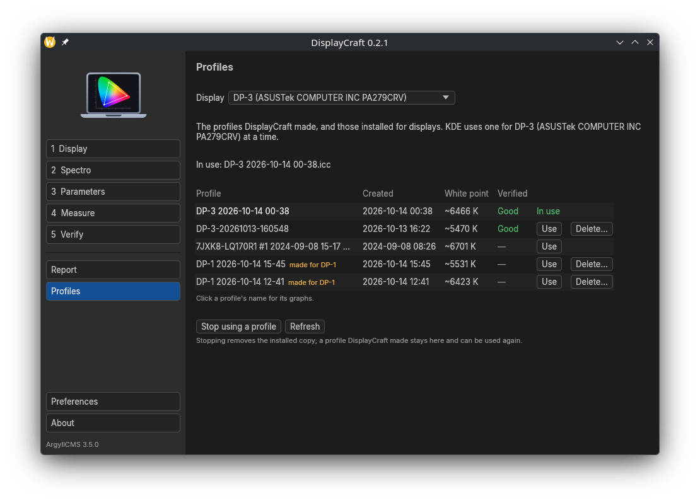
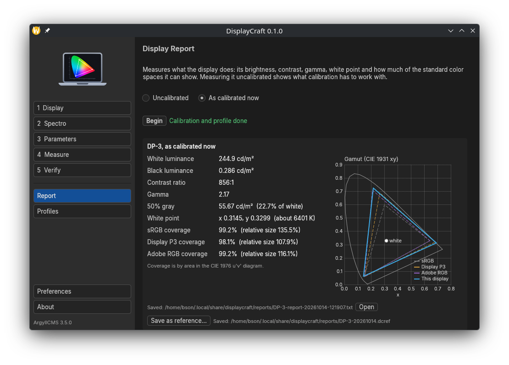
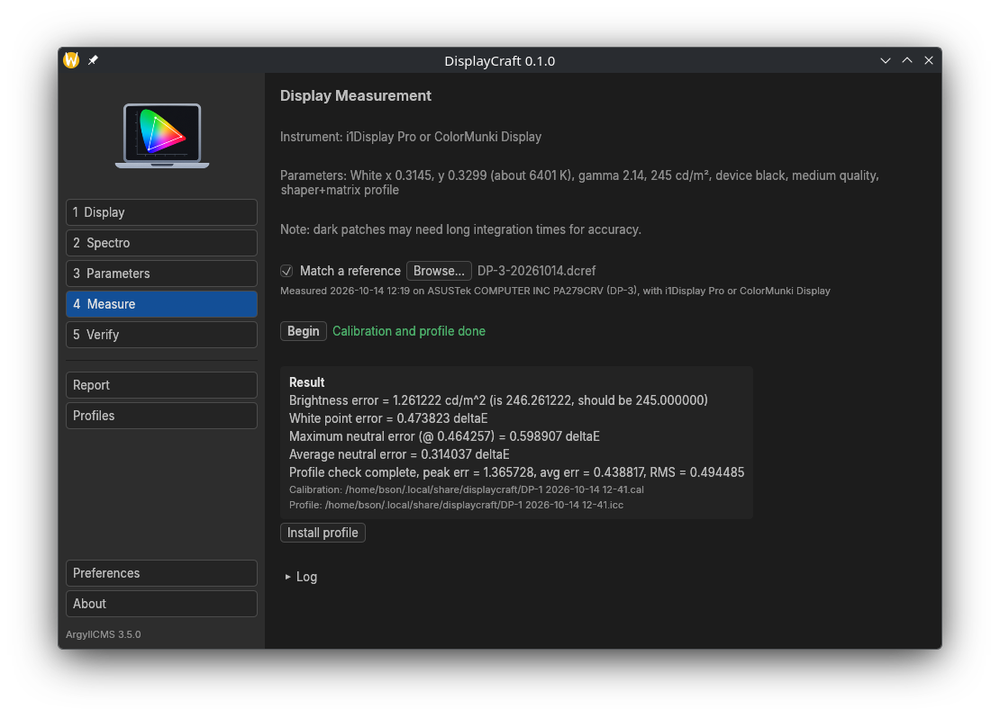

# DisplayCraft

Display calibration and profiling for Linux, macOS and Windows, written in
Rust with the look of the ArtCraft applications (egui with the ArtCraft
`craft-ui` library).

## What it does

DisplayCraft walks through calibrating a display with a colorimeter or
spectrophotometer: pick the display, then the instrument (with a
colorimeter correction if wanted), set the targets (white point,
brightness, gamma), and measure.

Measuring calibrates the display, makes an ICC profile (shaper+matrix or
LUT) from a set of measured patches, and installs it. The targets are a
white point, a tone curve, and optionally white's brightness and a black
point: black can be raised from the display's deepest, for a contrast
range like print's, with the dark grays kept neutral.

Before calibrating, a monitor's own controls can be set from its menus
while black, 50% gray and white are read over and over, each shown against
its target with how far its color is from the target white.

Verification measures how accurately a profile describes the display, and
gives a printable HTML report with charts; results can be exported as CSV.

The profiles page shows which profile a display uses, and switches,
removes or deletes them. Profiles can be viewed as graphs: calibration
curves, tonal response and gamut. A display report measures brightness,
contrast, gamma, white point and gamut coverage, uncalibrated or as
calibrated.

A display report can be saved as a reference, and other displays, on the
same computer or elsewhere, calibrated to match it: the same white point,
brightness, black point and 50% gray, so they look alike. Each profile can
have one saved with it too, so a display that has drifted can be brought
back to how it looked when the profile was made.

## Download

The [releases](https://github.com/bson/displaycraft/releases) are ready to
run, with ArgyllCMS included; there's nothing to build or install besides
them. They have:

- Linux: an AppImage, for KDE Plasma 6.4 or later, or a desktop with an X
  server or XWayland. It needs `chmod +x` before it runs.
- macOS: a disk image with `DisplayCraft.app`, for Apple Silicon Macs.
- Windows: an installer, which installs for the current user without
  administrator rights, and a portable zip, for 64-bit Windows.

None are signed. macOS asks before the first launch: allow it in System
Settings > Privacy & Security, or run `xattr -dr com.apple.quarantine
DisplayCraft.app`. On Windows, SmartScreen warns before the first run.

macOS 27 has a bug that can leave the display black (though on) after a
program has changed its calibration curves. DisplayCraft and its
ArgyllCMS work around it. If a display is ever left black anyway, running
`dispwin -d 1 -L` from `DisplayCraft.app/Contents/Resources/argyll/bin`
(over SSH, for instance) brings it back.

## Instruments

These are the instruments ArgyllCMS supports for measuring displays, and
so the ones DisplayCraft knows. Their support is ArgyllCMS's, and not all
of them have been tested with DisplayCraft.

- Calibrite and X-Rite: i1Display Pro, Pro Plus and Studio, ColorMunki
  Display, ColorChecker Display, Pro and Plus (and other i1Display 3
  based colorimeters); i1Pro, i1Pro 2 and i1Pro 3 (and EFI ES-1000 and
  ES-2000); ColorMunki Design, Photo and i1Studio; ColorMunki Create and
  Smile; DTP92 and DTP94
- GretagMacbeth: Eye-One Display 1, 2 and LT; Eye-One Monitor; Huey
  (including the Lenovo W built-in one); Spectrolino; SpectroScan and
  SpectroScanT
- Colorimeters treated as an Eye-One Display: HP DreamColor and APS,
  CalMAN X2, LaCie Blue Eye, Sequel MonacoOPTIX, Chroma 4 and 5
- Datacolor: Spyder 1, 2, 3, 4 and 5, SpyderX, SpyderX2, and Spyder and
  SpyderPRO (2024)
- JETI: specbos 1201, 1211 and 2501; spectraval 1501 and 1511
- Klein: K-10 (reported to work with the K-1 and K-8 too)
- Image Engineering: EX1
- Hughski: ColorHug and ColorHug2
- Colorimètre HCFR

The Spyder 2 needs its firmware, and the Spyder 4 and 5 their calibration
data, copied from the vendor's software with ArgyllCMS's `oeminst`, which
comes with DisplayCraft.

## Requirements

- One of:
  - KDE Plasma on Wayland. X11 sessions (Plasma, GNOME) and other Wayland
    desktops work through ArgyllCMS's X11 support; which profile is in use
    comes from KDE. ArgyllCMS checks the platform when DisplayCraft starts,
    and DisplayCraft won't run anywhere it reports the platform as
    unsupported.
  - macOS.
  - Windows, 64-bit.
- A supported measuring instrument. On Linux the user needs permission to
  access it through a udev rule; where the system has none, DisplayCraft
  offers to install ArgyllCMS's, asking for an administrator password.

On Linux, Preferences shows which of ArgyllCMS's display systems (KDE
Plasma on Wayland, or X11) DisplayCraft found this session calls for, and
can set it to one of them, or to another ArgyllCMS installed elsewhere.

## Where things are kept

Calibrations and profiles, verification reports (in `verify/`), display
reports (in `reports/`) and preferences (`settings.toml`) are kept in:

- Linux: `~/.local/share/displaycraft/`, with preferences in
  `~/.config/displaycraft/`
- macOS: `~/Library/Application Support/DisplayCraft/`
- Windows: `%APPDATA%\DisplayCraft\`

## How it works

The measuring is done by ArgyllCMS, which DisplayCraft runs as separate
programs, and which comes with it. It's a modified ArgyllCMS: on KDE Plasma
under Wayland it shows test patches and loads calibrations through KWin,
while keeping ArgyllCMS's X11 support, used on X11 sessions and, through
XWayland, on other Wayland desktops. On macOS and Windows it's ArgyllCMS's
own support for those systems.

Its About page links to the source of DisplayCraft and of the modified
ArgyllCMS it comes with.

DisplayCraft is not affiliated with ArtCraft.

## Building from source

This isn't needed to use DisplayCraft: the releases above are complete.
It's for working on DisplayCraft itself, and needs Rust 1.95 or later.

On Linux:

    cargo run --release

To install it for the current user, with its icon and an entry in the
application launcher:

    ./install.sh               # or PREFIX=/usr/local ./install.sh
    ./install.sh --uninstall

Run from source, DisplayCraft uses the ArgyllCMS in
`DISPLAYCRAFT_ARGYLL_BIN`, or on Linux `/opt/argyll-kde-wayland/bin`, or on
macOS the one inside an installed `DisplayCraft.app` (in `/Applications` or
`~/Applications`).

The modified ArgyllCMS is the `argyllcms` submodule
([bson/ArgyllCMS](https://github.com/bson/ArgyllCMS)); the packaging
scripts below build it along with DisplayCraft:

    git submodule update --init

### AppImage

`packaging/appimage/build.sh` builds a single AppImage containing
DisplayCraft and ArgyllCMS, in an Ubuntu 24.04 container (podman or
docker), so it runs on any distribution. It's written to `dist/`.

### macOS

`packaging/macos/make-app.sh` builds `DisplayCraft.app`, with ArgyllCMS
inside, in a disk image in `dist/`, on a Mac with Xcode's command line
tools and Rust. It builds for the Mac's own processor.

### Windows

`packaging\windows\make-app.ps1` builds DisplayCraft with ArgyllCMS on a
Windows machine with rustup, downloading the rest (a MinGW-w64 compiler,
ArgyllCMS's jam and Inno Setup) into its cache. It makes the portable zip
and the installer, in `dist\`.

### Releases

On GitHub, the Build workflow makes test builds of the AppImage, the macOS
app and the Windows zip and installer when run from the Actions tab, and
publishes a release with all of them when a version tag (`v0.1.0`,
matching `Cargo.toml`) is pushed. Each downloads as it is, without being
zipped again.

## License

MIT or Apache-2.0, at your option. See NOTICE for the third-party material
included.
